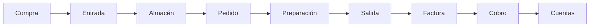
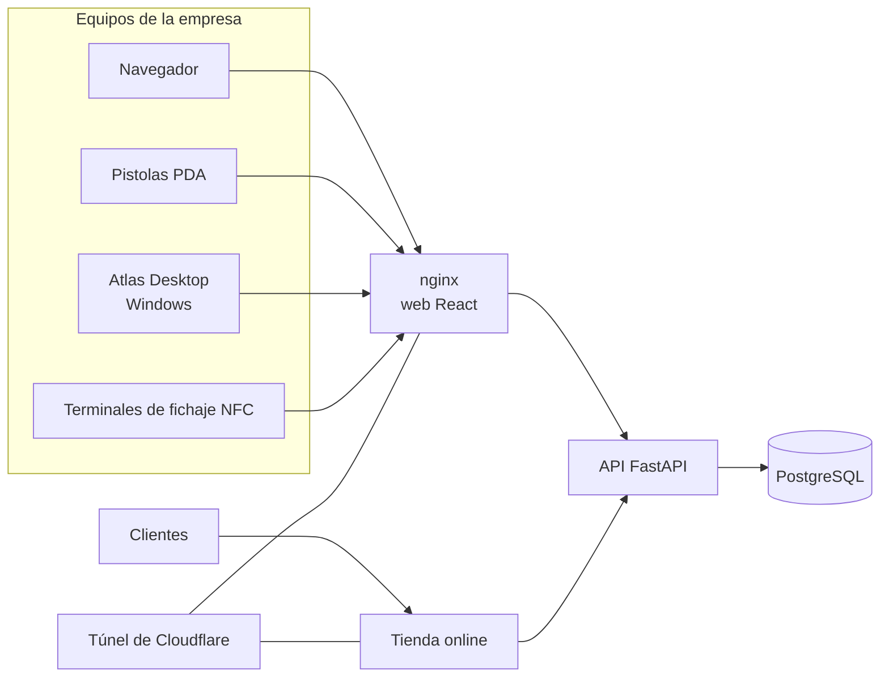

# Atlas

**Gestión de almacén, pedidos, logística, facturación, economía y personal en una sola aplicación.**

### 👉 [Ver la guía, las capturas y el recorrido completo en atlasdb.es/sobrenosotros](https://atlasdb.es/sobrenosotros)

Diseñado y desarrollado por **Ismael Hernández Rocamora** ([@ismaelgakill](https://github.com/ismaelgakill)).

> El código de Atlas es privado. Este repositorio explica qué es, cómo funciona y cómo está hecho.

---

## Qué es

Atlas sustituye las hojas de cálculo, los albaranes a mano y los programas sueltos de cada departamento por **una sola
aplicación** que comparten el almacén, la oficina, los transportistas y Recursos Humanos.

Lleva lo que entra, lo que se guarda, lo que se vende y sale en camión, quién lo ha hecho, cuánto se factura y se cobra,
y cuánto entra y sale cada mes. Cada caja tiene su matrícula y cada paso queda apuntado con quién y cuándo.

Nadie vuelve a teclear lo que ya está en el sistema: el albarán sale de las cajas que se cargaron, la factura de los
albaranes, y el resumen económico y los asientos, de todo lo anterior.

## Qué hace

| Área | Qué incluye |
|---|---|
| **Almacén** | Naves y ubicaciones, palets con lote y matrícula, picking, reubicaciones, inventario y trazabilidad completa |
| **Pedidos** | Colas de trabajo para los operarios (ordenador o pistola PDA), preparación, cajas, palets de envío y expedición |
| **Compras** | Proveedores, pedidos de compra, citas en el muelle, control de accesos y recepción |
| **Logística** | Agencias y tarifas, planificación de cargas, flota propia, seguimiento, incidencias y devoluciones |
| **Documentos** | Etiquetas, albaranes, hoja de carga, packing list, CMR y documentos de mercancía peligrosa, generados solos |
| **Facturación** | Facturas desde los albaranes, rectificativas, vencimientos, remesas SEPA y límite de crédito |
| **Economía** | Ingresos, gastos y resultado por día, mes y año, y contabilidad lista para la gestoría |
| **RRHH** | Empleados, contratos y convenios, fichajes con chapa NFC, vacaciones, nóminas y portal del empleado |
| **Tienda online** | Web para los clientes conectada al stock y a los pedidos, con su estudio de Marketing |

Los módulos se encienden cuando hacen falta: lo que una empresa no usa, no se ve.

## Cómo funciona

- **Se instala en un servidor de la propia empresa** (un NAS, un PC) con Docker. Funciona en la red local sin depender de
  internet, y se publica fuera a través de un túnel de Cloudflare, sin abrir puertos.
- **Una sola base de datos PostgreSQL**, organizada por esquemas (almacén, pedidos, logística, RRHH, facturación,
  contabilidad…), con migraciones versionadas.
- **Permisos por transacción**: cada acción tiene su permiso, agrupados en rangos editables, con registro de auditoría.
- **Atlas Desktop**: programa de Windows propio (Tauri + Rust) con pestañas, impresión directa, etiquetadoras USB
  (ZPL), lectores NFC, modo quiosco y actualizaciones firmadas que reparte el propio servidor.
- **Copias de seguridad** diarias y cifradas, y aviso de mantenimiento mientras se actualiza.

## Cómo está hecho

| | |
|---|---|
| **Backend** | Python · FastAPI · SQLAlchemy · Alembic · PostgreSQL · Pydantic |
| **Frontend** | TypeScript · React · Vite · React Query · tipos generados desde OpenAPI |
| **Escritorio** | Rust · Tauri 2 · WebView2 |
| **Infraestructura** | Docker Compose · nginx · Cloudflare Tunnel · GitHub Actions |

En cifras:

- **~62.000 líneas** de Python en la API y **~66.000** de TypeScript en la web.
- **627 rutas** en la API y **109 migraciones** de base de datos.
- **851 pruebas automáticas**, que se pasan contra SQLite y contra PostgreSQL en cada cambio.
- **Integración y despliegue continuos**: cada versión que pasa las pruebas se despliega sola en el servidor de
  producción, con copia de la base de datos antes de cada actualización.

## Ver más

- 🌐 **Guía completa con capturas:** [atlasdb.es/sobrenosotros](https://atlasdb.es/sobrenosotros)
- 💼 **Contacto:** a través de [GitHub](https://github.com/ismaelgakill)

---

Atlas · desarrollado desde abril de 2025 por Ismael Hernández Rocamora.
